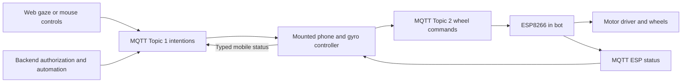

# IRIS team plan

The robot uses the MQTT architecture documented in [robot operation](robot-operation.md) and [shared interfaces](interfaces.md). Product goals are in [idea.md](idea.md). The ESP8266 firmware exists in `bot/`; frontend/backend messaging and the mounted phone controller remain application work.

## Ownership

| Member | Responsibility | Paths and contract |
| --- | --- | --- |
| Arunya | ESP8266 hardware/firmware, phone mounting, and gaze tracking | `bot/`, planned `apps/web/src/lib/gaze/`; [hardware and gaze](hardware-gaze.md) |
| Sahil | Backend authorization/MQTT sessions, AI pipeline, web controls, shared application schemas | `apps/server/`, `apps/web/`, planned `packages/protocol/`; [backend and web](backend-web.md) |
| Harnoor | Kotlin/Android mounted phone app, gyro translation, camera/audio/TTS, media integration, demo/pitch | Planned Android project under `apps/mobile/`, planned `apps/web/src/lib/rtc/`; [mobile](mobile.md) |

## Architecture

The backend coordinates one authorized control session; the phone is the sole normal publisher of wheel commands. Everyone uses the same broker namespace. The phone and ESP need broker connectivity; a laptop address is not part of the robot control path. Current prototype broker settings and the required private-broker/TLS/access-control migration are documented in [robot operation](robot-operation.md#password-process-and-protection-against-interception).

Camera/audio may use WebRTC with signalling over MQTT, and utterance uploads use the backend HTTPS API. These media paths do not carry motor commands. There is no IR or ultrasonic guard in the current firmware, so the demo cannot claim obstacle avoidance.

## Integration milestones

| Checkpoint | Arunya | Sahil | Harnoor |
| --- | --- | --- | --- |
| Contracts | Confirm `bot/` target, wiring, calibration mount, and existing ESP payloads | Validate Topic 1 schema and session ownership | Mirror the application schema and exact Topic 2 envelope |
| Command path | Confirm firmware build/provisioning | Publish authorized intentions against a simulated phone | Receive intentions and publish signed wheels in a simulation |
| Control loop | Gaze/mouse events and deliberate enable/stop | Held-input heartbeat, stale state, and expired sessions | Mount calibration, gyro correction, intention expiry, and disarm |
| Telepresence | Stable mount and gaze calibration | Three-card confirmation flow and AI pipeline | WebRTC media with MQTT signalling, speech capture, TTS |
| Reliability | Supervised forward/reverse/turn/stop checks | Duplicate/expired messages and stale status UI | Upstream loss, broker loss, backgrounding, and reconnect while disarmed |
| Demo | Gaze accuracy and observed robot behavior | Measured speech-to-card latency | Record a repeatable demo and actual stop/reconnect measurements |

Use mouse input and a simulated phone while gaze/mobile work is incomplete. Simulations publish application intentions/status without driving real motors. Test firmware command handling on hardware only in the supervised setup. No component should depend on a synthetic obstacle flag or a different board's pin map.

## Team working rules

Use [shared interfaces](interfaces.md) for application events, [robot operation](robot-operation.md) for the phone controller, and [MQTT commands](mqtt.md) for firmware fields. Keep credentials in ignored local configuration and redact command passwords from logs. Coordinate schema changes across senders and receivers. Implement only inside the relevant component boundaries.

The existing auth/database scaffold is still present. MQTT access and control-session authorization remain required; a local demo mock must not be described as production authorization. No instruction in this plan removes existing authentication code.

## Demo fallbacks

| Failure | Fallback |
| --- | --- |
| Gaze unreliable | Mouse mode using the same intention publisher and stop policy. |
| Media unavailable | Show a clear disconnected state or a recorded telepresence demonstration; keep MQTT command freshness independent of media processing. |
| Speech recognition unavailable | User-triggered recording or Android recognition fallback; publish the same transcript event. |
| LLM unavailable | Canned candidate responses that still require confirmation. |
| Robot control unreliable | Disarm, cut motor power if needed, and demonstrate the interface without live movement. |

The project has one robot control path: frontend/backend intentions → mounted phone with gyro correction → ESP8266 wheel commands, all through MQTT.
