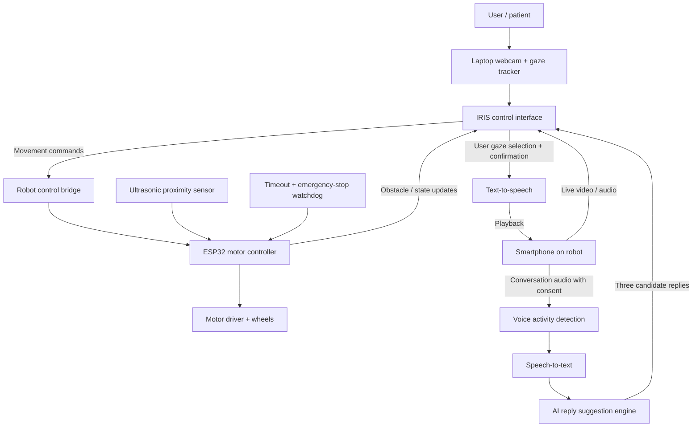

# IRIS

**Your Eyes. Your Voice. Your World.**

**AI-powered eye-controlled telepresence and communication robot**  
**Hackathon:** Upside Down.exe (3–4 November 2026)  
**Selected problem statement:** **PS-02 — Zero-Prompt AI (Kill the Chatbox)**  
**Project stage:** Hackathon prototype / proof of concept

---

## 1. The idea in one paragraph

**IRIS** is an assistive telepresence system designed for people with severe motor impairments who may be unable to operate a conventional joystick, keyboard, or mouse, and may also find speaking difficult. A person uses their **eyes** to navigate a small, camera-equipped mobile robot remotely. When someone speaks near the robot, an **event-driven AI pipeline** detects the speech, transcribes it, understands the conversational context, and automatically offers a few possible replies on the user's screen. The user selects a response with their gaze, confirms it, and the robot **speaks it aloud**. The robot can also react autonomously to obstacles and connection failures, making the system more than a remotely controlled RC car.

> **Important distinction:** IRIS provides **remote presence and communication**, not physical transport of the patient's body. Its value is enabling someone to visit spaces and interact with people remotely without having to travel there physically.

## 2. The real problem

A person with significant motor limitations may face two simultaneous barriers:

1. **Limited independent interaction with places outside their room.** They may depend on others to carry a phone, arrange a video call, or move a device into another room.
2. **Slow or difficult communication.** Typing messages, using a touchscreen, or selecting individual letters with eye movements can be tiring and time-consuming.

Traditional video calls still require another person to position or carry a device. Traditional RC cars require manual controls. Conventional chatbots wait for typed prompts. **IRIS combines remote navigation, eye-gaze input, and proactive conversation assistance in a single experience.**

**Intended users:** People with severe motor impairments who retain usable eye control and can be calibrated successfully; potential settings include a home, care facility, rehabilitation space, or a controlled hospital setting with permission.

## 3. Why IRIS fits PS-02: Zero-Prompt AI

**PS-02 requires AI that reacts to real-world events without the user having to open a chatbox and type a prompt.** IRIS does this through an ambient conversational workflow and safety events.

| PS-02 requirement | IRIS implementation |
|---|---|
| React to real-world events | Microphone detects another person speaking; sensors detect obstacles; connection watchdog detects lost control. |
| AI decides in context | Speech-to-text and an LLM generate context-relevant reply options; obstacle logic decides whether movement is safe. |
| Take meaningful action | Displays gaze-selectable responses, speaks the confirmed response through the robot, and stops movement when unsafe. |
| Keep the person in control | **The AI never speaks a suggested answer without explicit gaze confirmation.** |
| Handle errors | On gaze-tracking loss, Wi-Fi timeout, low confidence, or obstacle detection, the robot stops and displays a clear state. |
| No chatbox | The primary interface is eye gaze, a live robot feed, contextual response cards, and event-triggered assistance. |

### Primary trigger → decision → action → outcome

1. **Trigger:** Someone near the robot says, “Hey, how are you feeling?”
2. **Perception:** Voice activity detection starts speech recognition; the system receives a transcript.
3. **AI decision:** The model identifies the utterance as a question and proposes three concise, neutral responses.
4. **Human selection:** The user looks at a response card and confirms the choice.
5. **Action:** The robot's speaker converts the selected text to speech.
6. **Outcome:** The other person hears the user's chosen response and can continue the conversation.

**Secondary autonomous chain:** An obstacle appears → distance sensor reports danger → motor controller rejects forward movement → robot stops → UI reports “Obstacle detected.” This is a deterministic safety rule, not something that should depend on a generative model.

## 4. Core features

### A. Eye-controlled navigation

- Use the laptop webcam for gaze tracking and calibration.
- Display **large on-screen controls** (Forward, Left, Right, Backward, Stop) alongside the live robot camera feed.
- Use a gaze dwell to select a movement command; issue **short, bounded movement bursts**, rather than allowing indefinite motion after a glance.
- Provide a prominent Stop action and an **independent physical emergency-stop option** for the demo operator.
- If tracking becomes unreliable or control packets stop arriving, the robot **automatically stops**.

### B. Remote video, audio, and presence

- A smartphone mounted on the robot provides a camera, microphone, speaker, and network connection when available.
- The user views the live camera feed and hears people near the robot.
- The robot can travel within a **small, controlled indoor demo area**.

### C. Zero-prompt AI conversation

- Detect speech events near the robot without requiring the user to type.
- Convert captured speech to text.
- Generate **three short possible replies** appropriate to the detected question or conversation.
- Display them as **large gaze-selectable cards**.
- Require an intentional **confirmation step** before sending text to speech.
- Speak the selected response through the robot.
- Offer an **“Other / Type with gaze keyboard”** fallback so users are not restricted to AI-suggested statements.

### D. Safety and autonomy

- Ultrasonic/proximity sensor prevents obvious collisions during forward movement.
- ESP32 motor watchdog stops the robot if control commands stop or communication fails.
- Tracking-status indicator: calibrated / uncertain / lost.
- Emergency stop always overrides AI and navigation.
- Display readable error states instead of silently continuing.

### E. Optional enhancements (only after the MVP works)

- Saved personalized phrases: “Please come here,” “I need assistance,” “Can you repeat that?”
- Adjustable synthetic voice, speech rate, and language.
- Conversation history stored locally with consent.
- Low-bandwidth mode for unstable Wi-Fi.
- Quick navigation presets within a mapped, supervised environment.
- A separate **request assistance** card that alerts a caregiver in the prototype.

## 5. End-to-end user journey

1. User opens the **IRIS control interface** on a laptop.
2. User performs a short webcam gaze calibration.
3. Live video from the robot appears on the laptop.
4. User looks at navigation controls to steer the robot toward another person.
5. Person near the robot says, “Do you need anything?”
6. The speech pipeline automatically detects and transcribes the question.
7. AI suggests:
   - “Could you please bring me some water?”
   - “I'm okay, thank you.”
   - “I'd like to talk for a minute.”
8. User gazes at the preferred option and confirms it.
9. The robot speaks that response.
10. If an obstacle enters the path, the robot independently stops and warns the user.

## 6. Proposed architecture



### Practical hardware

| Component | Function | Priority |
|---|---|---|
| 2WD/4WD RC chassis with motors and battery | Mobile base | Essential |
| ESP32 | Receives movement commands; applies stop/watchdog rules | Essential |
| Compatible motor driver (e.g., TB6612FNG or L298N) | Powers motors | Essential |
| Laptop with webcam | Eye tracking and control UI | Essential |
| Smartphone (or equivalent camera/audio device) | Live remote video, microphone, speaker | Essential for telepresence demo |
| Ultrasonic distance sensor | Obstacle detection | High |
| Physical emergency-stop switch / accessible power cut | Safety override | High |
| LEDs / buzzer | Visible motor / connection status | Optional |

**Hardware caution:** Match motor-driver voltage/current ratings to the motors; use a suitable battery and wiring. A motor driver is required—don't power the motors directly from ESP32 GPIO pins.

### Suggested software stack

| Layer | Candidate implementation |
|---|---|
| Gaze | WebGazer.js or a tested MediaPipe-based gaze/face pipeline |
| User interface | React / JavaScript web app with large target buttons |
| Robot networking | WebSocket or HTTP via a local Node.js/Python server |
| Video/audio | WebRTC or a tested low-latency local streaming solution |
| Voice activity detection | Browser audio activity detection or VAD library |
| Speech-to-text | Whisper / browser or cloud speech recognizer |
| AI suggestions | Gemini/OpenAI-compatible LLM API, with short structured output |
| Text-to-speech | Browser speech synthesis or a TTS service played on robot smartphone |
| Robot firmware | Arduino framework for ESP32 |

**Engineering note:** Test webcam calibration and video/audio transport first—these are the two integration risks most likely to block the demo. A prototype can use simple fixed-direction gaze zones rather than precise pixel-level eye tracking.

## 7. Example system messages / data flow

**Robot movement command (illustrative):**

```json
{
  "type": "move",
  "direction": "forward",
  "duration_ms": 200,
  "sequence": 42
}
```

**Robot state (illustrative):**

```json
{
  "type": "robot_state",
  "connected": true,
  "obstacle_detected": false,
  "movement_enabled": true
}
```

**AI suggestions (illustrative):**

```json
{
  "heard": "Do you need anything?",
  "suggestions": [
    "Could you please bring me some water?",
    "I'm okay, thank you.",
    "I'd like to talk for a minute."
  ],
  "requires_user_confirmation": true
}
```

The AI should generate **choices**, never claims about the user's medical condition, emotions, preferences, or decisions as if they were facts. If recognition confidence is poor, show the transcript and offer “Repeat / Ignore” instead of pretending it understood.

## 8. Hackathon MVP: what we will actually finish

**Non-negotiable deliverables:**

- [ ] RC robot moves reliably in four directions and stops.
- [ ] ESP32 watchdog stops robot when commands disconnect.
- [ ] Laptop webcam can select large UI controls with gaze after calibration.
- [ ] Remote live camera feed from the robot is visible on the laptop.
- [ ] A teammate speaks near the robot and the utterance gets transcribed.
- [ ] AI generates three reply cards without a typed prompt.
- [ ] User gaze-selects and confirms a reply; it plays through the robot's speaker.
- [ ] Obstacle detection stops the robot during the demo.
- [ ] One successful end-to-end demo can be repeated reliably.

**Not in the overnight MVP:** hospital-wide autonomous navigation, elevators, autonomous patient transport, medical decision-making, facial recognition, autonomous speech without user consent, or deployment in actual clinical areas.

### Suggested build order (approximately 15.5 hours of core hacking)

| Phase | Target | Approx. effort |
|---|---|---:|
| 1 | Chassis, ESP32 motor commands, stop/watchdog | 2.5 h |
| 2 | Live video/audio from robot phone | 2 h |
| 3 | Webcam gaze calibration + 5 large control zones | 2.5 h |
| 4 | Speech detection → transcription → AI reply cards → TTS | 3 h |
| 5 | Gaze-based reply selection, confirmation, integration | 2 h |
| 6 | Obstacle demo, reconnect/error recovery, reliability testing | 1.5 h |
| 7 | PPT, scripted pitch, repeatable demonstration | 2 h |

The tasks can overlap across a team. **Prioritize a dependable demo over adding optional features.**

### Team split (example: four members)

- **Member 1 — Robotics:** ESP32 firmware, chassis, motor driver, obstacle safety.
- **Member 2 — Gaze interface:** Calibration, navigation UI, reply-card selection.
- **Member 3 — AI/audio:** VAD, STT, response generation, TTS, permissions.
- **Member 4 — Integration/demo:** Phone streaming, networking, testing, end-to-end coordination, pitch.

## 9. Live judge demonstration (2–3 minutes)

**Act 1 — Presence:** A team member plays the patient and uses only eye movements to move IRIS toward a friend at the other side of the demo area. The robot's live camera feed appears on the laptop.

**Act 2 — Conversation:** The friend asks, “Hey, do you need anything?” The system automatically transcribes the question and shows three reply suggestions. The user selects and confirms “Could you please bring me some water?” with gaze. IRIS speaks the sentence aloud.

**Act 3 — Autonomy:** While the user requests forward movement, a box is put in the robot's path. The proximity sensor triggers a stop; the interface shows the reason.

**Act 4 — Resilience:** Briefly interrupt the control connection or intentionally remove the face from webcam tracking; the robot remains stopped rather than continuing an old command.

**Closing line:** *“IRIS gives people who cannot easily move or speak a way to explore, connect, and express themselves using their eyes—while AI handles the work between intention and action.”*

## 10. What we will measure

Useful prototype metrics (report observed values, not invented claims):

- **Gaze selection accuracy:** Correct selection rate across a small series of trials.
- **Navigation reliability:** Successful forward/turn/stop commands out of attempted commands.
- **Speech-response latency:** Time from the end of a spoken question to suggested replies appearing.
- **Conversation completion:** Whether a user can select and speak a chosen reply without a keyboard/mouse.
- **Safety stop:** Time until motors stop after an obstacle or network/control loss.

## 11. Risks, accessibility, and ethics

- **Not a medical device:** This is a supervised hackathon prototype, not suitable for unsupervised hospital use.
- **Not universal accessibility:** Webcam gaze control may not work for every patient; lighting, head movement, eye conditions, fatigue, or calibration can reduce accuracy.
- **Avoid accidental activation:** Use large targets, dwell + confirmation, motion time limits, and a stop watchdog.
- **The user owns their words:** Never make AI-generated text speak automatically. Provide a way to reject or compose a custom response.
- **Privacy:** Obtain consent from everyone whose audio/video is captured. Do not record or upload hospital conversations without authorization. Minimize storage of transcripts, audio, and video.
- **Fail safely:** On uncertain gaze, lost link, obstacle, or conflicting instructions, stop motors and wait for renewed user control.
- **Use controlled spaces:** Demonstrate only on a clear, supervised tabletop/floor course away from patients, stairs, traffic, and hazardous equipment.

## 12. Beyond the hackathon

Future versions could offer better eye-tracking hardware, multi-language speech, personalized communication boards, mapped navigation, caregiver communication, safer obstacle avoidance, better network handoff, and accessibility testing with users who have lived experience of motor disabilities.

These are **future research and development possibilities**, not claims about the overnight MVP.

## 13. Project description for submission

**IRIS** is an AI-powered, eye-controlled telepresence and communication robot designed for people with severe motor impairments. Using a laptop webcam, users navigate a small mobile robot via gaze-based controls and experience remote spaces through the robot's live camera and audio. When someone speaks nearby, a zero-prompt AI pipeline detects and transcribes the speech, proposes contextual reply options, and lets the user choose a response with their eyes. After explicit confirmation, the robot speaks the selected words aloud. An ESP32 motor controller, obstacle detection, and command watchdog add autonomous safety behaviour. IRIS demonstrates how sensor input, AI, and physical robotics can work together to support remote presence and communication without a traditional chatbox.

---

**IRIS — Your Eyes. Your Voice. Your World.**
