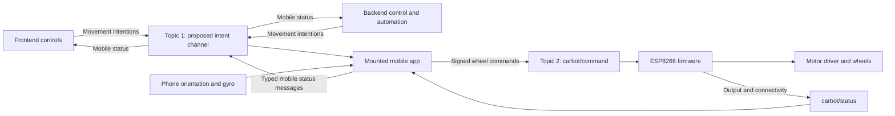

# Robot operation and team integration

This is the frontend, backend, and mobile integration contract for Teekhi Nazaar. The phone is mounted rigidly on the robot beside the ESP8266, so the phone's motion sensors measure the robot's orientation. Frontend and backend send movement intentions to the phone; the phone uses orientation feedback to calculate wheel commands; the ESP drives the motors.

There are two MQTT **command channels**. Topic 1 carries high-level intentions between the frontend/backend and the phone. Topic 2 carries translated wheel commands from the phone to the ESP. The ESP's existing status topic remains a separate feedback channel.

The ESP firmware described below exists in this repository. Topic 1, the new mobile translation/controller, and backend control-session handling are the planned integration. This documentation adds no mobile, frontend, backend, or firmware implementation. Names, fields, and timings marked **proposed** define a starting contract for those teams; they are not existing ESP features.

## System architecture and responsibilities



The phone and ESP are attached mechanically to the same chassis. Their application communication uses MQTT over the network; mounting them together does not establish a USB, Bluetooth, or direct Wi-Fi data connection. Each device needs access to the configured broker. Being on the same local network is insufficient if the broker is unreachable.

| Component | Owns |
| --- | --- |
| Frontend | Forward, backward, left, right, speed, and STOP controls; sending fresh intentions while a control is held; displaying robot/mobile state. |
| Backend | User/device authorization, selecting one active control session per robot, automated intentions, and issuing broker credentials with suitable permissions. |
| Mounted mobile app | Validating Topic 1 messages, reading/calibrating orientation, calculating gyro corrections, publishing Topic 2 commands, disarming on faults, and relaying status. |
| ESP8266 | Provisioning Wi-Fi, checking the control password and supported command fields, setting signed wheel effort/servo output, enforcing its existing phone-control timeout, and publishing status. |

Frontend and backend can both originate movement, but only one controller may own a robot at a time. The backend must coordinate ownership so a user's controls and automation do not send conflicting intentions. The mounted phone is the sole normal publisher of wheel commands to Topic 2.

There are no IR inputs, edge alerts, automatic reversing at an edge, or IR lockout/re-arm checks. Gyro correction maintains the requested orientation; it does not restore desk-edge detection or detect obstacles.

## Initial setup and readiness

1. Secure the phone in its final mount and connect the motor hardware using the existing [firmware wiring](firmware-setup.md#existing-wiring). The phone must not rotate independently of the chassis during a session.
2. When the ESP has no valid saved network or cannot connect, join its `Lain_Setup` access point and open `http://192.168.4.1`.
3. Set the ESP control password, scan for a 2.4 GHz network, and save its Wi-Fi credentials. The ESP restarts, joins that network, connects to MQTT, subscribes to `carbot/command`, and publishes online status. With valid saved credentials it can connect directly at boot.
4. Give the mounted mobile app the same ESP control password through its future pairing/settings flow. Connect the phone, frontend, and backend to their permitted broker topics.
5. Calibrate the phone while the robot is stationary. Map phone axes to robot forward and vertical axes, establish the initial heading, and confirm clockwise/counterclockwise sign conventions.
6. Enable a control session only after calibration, fresh orientation readings, broker connectivity, and a recent full ESP status are available. The initial minimal online message alone does not prove calibration or password correctness. Drive only after an explicit enable action.

The Wi-Fi setup access point is a provisioning service. It does not provide the phone with an internet connection or configure mobile broker credentials. Reconnect the phone to a suitable network after provisioning. Firmware build/upload details remain in [firmware setup](firmware-setup.md).

## MQTT channels and message contracts

### Topic 1 for frontend and backend intentions

**Proposed topic name:** `teekhi-nazaar/esp12e_carbot/intent`. This is a new application topic; the current ESP does not subscribe to it. The topic embeds the target robot to support scoped broker permissions. The schema also includes `device_id` so the phone can reject an incorrectly addressed message.

Frontend and backend publish `type:"drive_intent"`; the phone subscribes and translates those intentions. The phone may publish `type:"mobile_status"` to the same Topic 1 for the frontend and backend to consume. Every subscriber filters by `type` and `device_id`. A status message must never be translated into motion, including when a client receives its own publication.

**Proposed drive intention:**

```json
{
  "type": "drive_intent",
  "device_id": "esp12e_carbot",
  "control_session_id": "session-42",
  "command_id": "drive-21",
  "seq": 21,
  "action": "forward",
  "speed": 40,
  "sent_at": "2026-11-04T10:00:00.000Z",
  "ttl_ms": 300
}
```

This timestamp is an example; a publisher supplies the current time for each new intention.

| Field | Meaning and validation in the mobile app |
| --- | --- |
| `type` | `drive_intent` for a movement/stop intention. |
| `device_id` | Exact target robot ID; currently `esp12e_carbot`. |
| `control_session_id` | The backend-authorized active session. This identifier alone is not a credential. |
| `command_id` | Unique ID for this message, used for tracing and duplicate suppression. |
| `seq` | Increasing integer within a session; reject duplicates and older movement messages. |
| `action` | `forward`, `backward`, `left`, `right`, or `stop`. |
| `speed` | Integer 0–100 representing requested motor effort. `stop` overrides speed and gyro correction. |
| `sent_at` | UTC creation time used with `ttl_ms` to reject expired intentions. |
| `ttl_ms` | Proposed validity of 300 ms. Enforce a configured maximum rather than trusting an arbitrarily long value. |

Mobile validation checks schema, target, active session, ordering, and expiry. The phone obtains the active session grant from an authenticated backend flow; a Topic 1 message cannot grant itself ownership. The backend must authenticate the controller; neither a topic name nor a claimed session ID proves identity. Publisher and phone clocks need a bounded offset for `sent_at` checks, established against a trusted clock during session setup. Also expire the active intention using a local monotonic timer. Do not rely on local arrival time alone to identify an old queued command.

A controller sends a new intention about every 100 ms while a movement is held, with a new ID, sequence number, and timestamp. Releasing a control sends `action:"stop"` immediately. If the same direction continues, repeated intentions renew freshness without resetting the phone's heading target. STOP or speed zero always commands zero motor output.

### Topic 2 for commands the ESP already understands

**Existing command topic:** `carbot/command`. The phone publishes; the ESP subscribes. Keep this exact topic and the following field names while using the current firmware.

The current ESP uses `broker.emqx.io:1883` over MQTT/TCP with empty broker username/password values. A phone or browser may access the same broker using `wss://broker.emqx.io:8084/mqtt`. These transports reach the same topic namespace. Production transport and access requirements are covered below.

Use the existing phone-control envelope for the mobile controller:

```json
{
  "password": "YOUR_ESP_CONTROL_PASSWORD",
  "source": "lain-mobile",
  "device_id": "esp12e_carbot",
  "phone_control": true,
  "armed": true,
  "left": 35,
  "right": 45,
  "cmd": "F",
  "pitch_deg": 0,
  "roll_deg": 0,
  "yaw_deg": 5
}
```

| Field | Existing ESP behavior |
| --- | --- |
| `password` | Must exactly match the ESP's current control password. |
| `source`, `phone_control` | `source:"lain-mobile"` plus `phone_control:true` select the existing timeout-enabled branch. Preserve the literal source string even for the new app. It is a compatibility marker, not sender authentication. |
| `device_id` | Must match `esp12e_carbot` on this branch. |
| `armed` | Boolean. Explicitly send true while enabled and false to disarm. The firmware defaults a missing value to true. |
| `left`, `right` | Both required JSON integers from -100 to +100. Positive drives that wheel forward, negative reverses, and zero stops it. Out-of-range values are rejected on this branch. |
| `cmd` | `F`, `B`, `L`, `R`, or `S` as a direction label. Actual motion comes from `left`/`right`, even if the label differs. |
| `pitch_deg`, `roll_deg`, `yaw_deg` | Optional orientation telemetry in degrees, default zero and clamped to ±180. The ESP does not calculate movement from these angles. |

There is no `speed` field consumed by the phone-control branch. The mobile app translates high-level speed and gyro feedback into `left` and `right`. Keep the orientation values relative to the calibrated robot axes and represent relative yaw in the ESP's ±180 degree telemetry range; the phone may track an unwrapped heading internally.

Publish fresh wheel values every 100 ms with QoS 0 and `retain=false`. Explicit stop/disarm uses QoS 1 and `retain=false`, including both required wheel fields:

```json
{
  "password": "YOUR_ESP_CONTROL_PASSWORD",
  "source": "lain-mobile",
  "device_id": "esp12e_carbot",
  "phone_control": true,
  "armed": false,
  "left": 0,
  "right": 0,
  "cmd": "S"
}
```

The current firmware also accepts plain `cmd`/`speed` or `left`/`right` commands, described in [the MQTT reference](mqtt.md). Those commands persist and bypass the phone branch's timeout; normal app operation uses the envelope above. Frontend/backend must not publish wheel values directly during a mobile-controlled session.

### Existing ESP status and proposed mobile feedback

The ESP publishes to `carbot/status`, with a minimal online message at connection and fuller status every two seconds. The mobile app subscribes and reads current wheel effort, phone-control state, servo angle, RSSI in dBm, and uptime in seconds. These values report commanded output, not measured wheel speed. There are no IR fields, heading measurements taken by the ESP, per-command acknowledgements, or an offline Last Will in the current firmware.

**Proposed mobile status on Topic 1:**

```json
{
  "type": "mobile_status",
  "device_id": "esp12e_carbot",
  "control_session_id": "session-42",
  "last_command_id": "drive-21",
  "state": "driving",
  "esp_online": true,
  "calibrated": true,
  "heading_deg": 5,
  "target_heading_deg": 0,
  "left": 35,
  "right": 45
}
```

The proposed `state` values are `disarmed`, `ready`, `driving`, and `fault`. The phone's `last_command_id` means it accepted/transformed the intention; it does not prove the ESP executed it or the robot moved. Topic 2 publish success or a broker acknowledgement is also not proof of physical motion. Expire ESP status locally, for example after a proposed six seconds without a fresh update, and expose that state to the frontend. Report mobile status periodically and on state changes, without reflecting it back as a drive intention.

## Translating intentions with phone orientation

### Establish the robot coordinate system

In this contract, forward/backward are relative to the robot chassis. Left/right request rotation about the robot's vertical axis. Positive robot yaw is clockwise, meaning a right turn viewed from above. Phone sensor axes depend on mounting; the mobile team must transform them into these robot axes and verify the sign on the actual mount.

A raw gyro measures angular velocity, normally in radians per second, rather than a heading angle. Use calibrated, fused device orientation together with gyro rate feedback; compensate drift and normalize units before control calculations. Gyro-only integration accumulates error. Android's [motion sensor documentation](https://developer.android.com/develop/sensors-and-location/sensors/sensors_motion) explains angular-rate units, rotation-vector orientation, and gyro drift.

Pitch and roll describe chassis tilt; yaw describes heading. The mount's calibration zero is the starting reference. Because the phone is fixed to the chassis, it measures chassis motion. The received intention sets the direction and base effort; phone tilt must not become an independent throttle source. Heading stabilization does not provide position, distance traveled, or measured ground speed.

### Movement and correction rules

| Intention | Mobile controller behavior |
| --- | --- |
| Forward | Capture the current heading when entering forward motion. Apply positive base effort and adjust the wheel difference to hold that heading. |
| Backward | Capture/hold the current heading while using negative base effort. Apply correction in robot yaw coordinates, including while reversing. |
| Left | Request a left turn while the intention remains fresh. Use gyro feedback to regulate the requested turn, rather than holding the old heading and cancelling the turn. |
| Right | Request a right turn while the intention remains fresh, with gyro feedback regulating it. |
| Stop | Set both wheels to zero and disarm. Gyro correction must not move the robot after a stop. |

Left/right are continuous turns while held; they do not imply a fixed 90-degree rotation. An angle-based turn would need an additional agreed intention schema. After a turn, entering forward/backward captures the new heading. Renewing an unchanged direction must not recapture heading every tick, because that would erase the accumulated correction error.

For heading hold, an illustrative calculation is:

```text
heading_error = shortest signed angle from current heading to target heading
correction = bounded adjustment using heading_error and measured yaw rate
left  = round(clamp(base_effort + correction, -100, 100))
right = round(clamp(base_effort - correction, -100, 100))
```

Here positive correction produces a rightward rotation with the existing motor wiring. With target heading 0 degrees, current heading +5 degrees, base effort +40, and an illustrative correction of -5, the output is `left:35`, `right:45`, as in the Topic 2 example. A backward command uses a negative base effort with the same robot-yaw convention; do not blindly invert correction because motion is reversed.

The mobile team must tune correction limits, response gains, filtering, and acceleration limits against the real chassis. Example numbers are illustrative, not tested controller settings. Turning starts from negative-left/positive-right for left, and positive-left/negative-right for right. Clamp the final effort and round to integers before publishing. The ESP's existing minimum PWM mapping remains: absolute effort 1–100 maps to PWM 85–255; zero disables the wheel. A value of 40 is therefore an effort request, not 40 percent measured speed or a guaranteed fraction of maximum ground speed.

## Command freshness and stopping

These proposed application timings use the ESP's existing fixed timeout:

| Signal | Timing | Owner |
| --- | --- | --- |
| Held intention on Topic 1 | Renew every 100 ms; validity 300 ms | Frontend/backend and phone, proposed |
| Orientation feedback | Sample locally more frequently than the wheel publish interval; reject stale readings | Mobile team chooses and validates the rate/age limit |
| Wheel command on Topic 2 | Publish latest computed values every 100 ms | Phone, proposed |
| Missing accepted phone drive command | Stop after more than 500 ms, or on detected MQTT/Wi-Fi loss | Existing ESP firmware |
| Full ESP status | Every two seconds | Existing ESP firmware |

Topic 1 expiry matters even when Topic 2 is healthy. If frontend/backend disconnects but the phone keeps re-publishing the last movement, the ESP's timeout never expires. The phone must stop/disarm when the upstream intention expires, its session is revoked, orientation becomes unavailable/stale, calibration is lost, ESP status becomes stale, or the control app becomes inactive. If it cannot send a stop because its broker connection failed, it stops publishing; the existing ESP phone timeout provides the fallback when the firmware loop continues running. None of these software paths substitutes for a physical power stop.

Use a clean command session and avoid persisting/queuing movement messages for delivery after reconnect. On reconnect remain disarmed, discard cached movement, and require fresh readiness and explicit enable. Defer new movement until a stop/disarm transition has been completed in the application; do not replay old queued drive packets after it.

Proposed Topic 1 commands use QoS 1 with `retain=false`; deduplicate by session and sequence. MQTT QoS 1 can deliver a message more than once, and retained messages are delivered to new subscribers, so neither a duplicate nor an old retained movement may start a new maneuver. Broker delivery acknowledgement is distinct from application/robot execution. These are MQTT protocol properties in the [OASIS MQTT specification](https://docs.oasis-open.org/mqtt/mqtt/v3.1.1/os/mqtt-v3.1.1-os.html).

The ESP currently does not enforce Topic 1 IDs, sequence numbers, expiry, or control sessions. It checks the accepted Topic 2 fields and password; it does not reject a previously recorded valid wheel command merely because it is old. Mobile-side freshness checks alone do not secure Topic 2 against replay by another publisher.

## Password process and protection against interception

### What the current ESP password does

The initial control password is `BOT_DEFAULT_CONTROL_PASSWORD` in the ignored local file `bot/include/bot_secrets.h`. Create it from the [example header](../bot/include/bot_secrets.example.h) during local setup. A valid stored EEPROM control password overrides that initial value at boot; an already provisioned board may therefore use a different password. Real passwords are not stored in the committed source or documentation.

The operator sets a control password of 4–49 characters through the ESP's setup page. The firmware stores it in EEPROM; the paired mobile app must use the same value in every Topic 2 command. For each incoming command the ESP parses JSON, compares `password` with its stored value, and ignores a mismatch before applying movement. This is a shared-secret application check: a sender without the matching value cannot pass that check.

If a password changes, update the paired phone as well and remain disarmed until the change is confirmed. A wrong-password message is silently ignored; status does not contain a dedicated password-valid flag. A broker publish acknowledgement cannot confirm password correctness. Keep the ESP secret in the phone's secure credential storage and out of Topic 1 messages, frontend bundles, source control, analytics, logs, and mobile status. The backend does not need the ESP payload secret simply to send high-level intentions.

### Why that password does not prevent interception

**Putting a password in JSON does not encrypt the message.** Current ESP firmware uses an ordinary `WiFiClient` and unencrypted MQTT on port 1883, with no broker credentials configured. A network observer or an unauthorized subscriber with topic access can obtain the command payload, including the password. Someone who obtains it can send valid commands, including replaying recorded messages. Use a unique control password and keep the local header private. EEPROM storage and the current setup page do not provide encrypted secret storage.

WSS protects the phone/browser connection to the broker. It does not encrypt the separate broker-to-ESP connection or prevent other broker clients with subscription permission from receiving payloads. Transport confidentiality comes from correctly configured TLS on **every** client-to-broker leg, including server-certificate validation. TLS terminates at the broker, which can still see routed payloads; it is not end-to-end application encryption. See [EMQX network and TLS documentation](https://docs.emqx.com/en/emqx/latest/guides/network/overview.html).

### Required access controls for a protected deployment

Use a private broker with authenticated clients, encrypted connections, and topic permissions. Authentication establishes client identity; authorization restricts which topics that client can publish or subscribe to. These are separate from the ESP JSON password check, as explained in [EMQX access control documentation](https://docs.emqx.com/en/emqx/latest/guides/security-guide.html).

| Role | Intended permissions |
| --- | --- |
| Authorized frontend/backend controller | Topic 1 for its assigned robot/session; no publication to Topic 2. |
| Mounted phone | Topic 1 for its robot, publication to Topic 2, and subscription to that ESP's status. |
| ESP | Subscription to Topic 2 and publication of its own status. |
| Other accounts/devices | No access to this robot's channels or credentials. |

The mobile app adds the ESP password after translating an authorized intention. The frontend uses application login and scoped broker credentials rather than exposing the ESP shared secret. Backend ownership checks and broker permissions enforce who can issue intentions; a typed JSON field such as `source` is not proof of identity.

Moving the existing ESP to a protected broker requires a future coordinated firmware/configuration change for TLS, certificate validation, broker authentication, and any per-device topic names. Merely changing port 1883 to 8883 is insufficient. The current `carbot/command` namespace and `esp12e_carbot` ID are shared identifiers; passwords and topic names alone do not isolate multiple robots. A fleet needs unique identities and broker topic permissions with matching firmware changes. No such security implementation or broker migration is performed by this documentation.

## Team handoff and acceptance criteria

Frontend/backend implement the proposed Topic 1 schema and agree one active authorized controller per robot. The mobile team implements the mount calibration, gyro feedback, command translation, timing, and status relay. The current ESP stays on its documented Topic 2 contract until a separately coordinated interface/security change.

Before enabling real driving, the integration should demonstrate:

- Forward/backward produce the correct wheel signs; left/right turn in the intended direction; release/STOP immediately sets zero output and disarms.
- A small heading disturbance is corrected during both forward and reverse driving. Repeated held intentions preserve the heading target; deliberate turns do not fight an old heading target.
- Expired, duplicate, incorrectly targeted, and unauthorized intentions never start or extend movement. Status messages on Topic 1 never reach the movement translator.
- Loss of Topic 1 freshness stops the phone's drive loop even if MQTT remains connected. Phone disconnection stops through the existing ESP timeout when its loop is running.
- Reconnect, sensor/calibration loss, session revocation, and app backgrounding return to a disarmed state. A stale queued drive packet does not restart motion.
- Wrong ESP passwords are ignored. The frontend distinguishes intention accepted, phone output sent, recent ESP output status, and actual observed movement.
- For a protected deployment, every broker connection is encrypted and authenticated, and an unrelated account cannot publish or subscribe to either command channel.

These criteria describe future integration work; they are not hardware validation results. For exact current field handling, see [`mqtt.md`](mqtt.md) and [`main.cpp`](../bot/src/main.cpp). For build, provisioning, and motor pin details, see [`firmware-setup.md`](firmware-setup.md).
