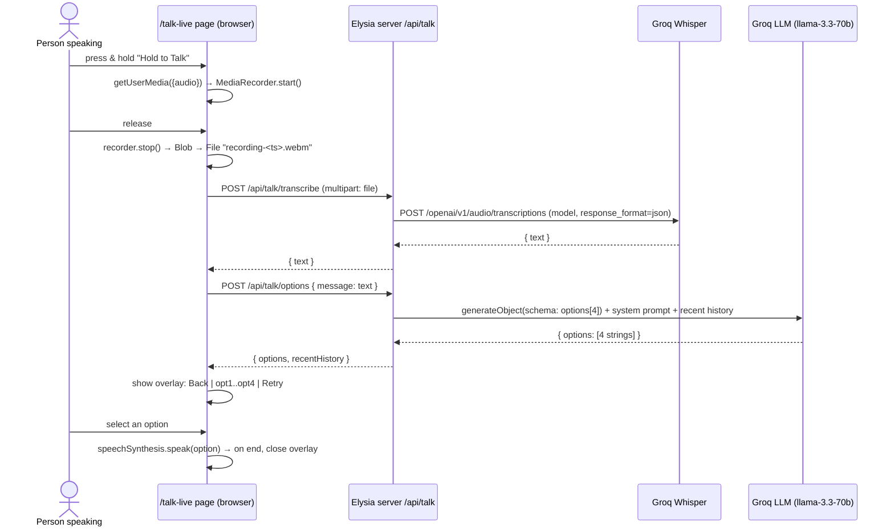

# Talk Live: how it works in gaze-connects

A reference write-up of the **Talk Live** feature in the `gaze-connects` repo. It covers what it does, every file involved, the request flow, the API contract, and the gaps to fix if we port it to IRIS.

**In one line:** someone holds a button and speaks → the browser records audio → the server transcribes it with Groq Whisper → the server asks a Groq LLM for **4 reply options** → the patient picks one → the browser reads it aloud with `speechSynthesis`.

---

## 1. Files involved

| Layer | File | Role |
|---|---|---|
| Entry point | `frontend/apps/web/src/lib/mode-navigation.ts` | `HOME_CARDS` has a "Talk Live" card → `/talk-live`; `ModeKey` and `MODE_ORDER` include `"talk-live"` |
| Entry point | `frontend/apps/web/src/components/modes/mode-grid-screen.tsx` | Home grid; renders the card with the `Mic` icon |
| UI | `frontend/apps/web/src/app/talk-live/page.tsx` | The whole feature UI: recording, upload, options overlay, TTS (~560 lines, one client component) |
| API client | `frontend/apps/web/src/lib/talk-live/api.ts` | `transcribeTalkAudio(file)` and `fetchTalkOptions(message)` |
| URL helper | `frontend/apps/web/src/lib/telegram/api-base.ts` | `toBackendURL(path)` resolves the backend origin from `NEXT_PUBLIC_BETTER_AUTH_URL` / `NEXT_PUBLIC_API_BASE_URL` |
| Shared state | `frontend/apps/web/src/hooks/use-mock-mode.ts` | Jotai atom, persisted in `localStorage` (`gaze-connect-mock-mode`): mock-mode on/off |
| Server route | `server/src/routes/talk.ts` | Elysia plugin, prefix `/talk`: `POST /transcribe` and `POST /options` |
| Server mount | `server/src/index.ts` | `.group("/api", app => app.use(talkRoutes))` → final paths `/api/talk/*` |
| Config | `server/.env.example` | `GROQ_API_KEY`, `GROQ_API_KEY_ALT_1..4`, `GROQ_CHAT_MODEL`, `GROQ_TRANSCRIPTION_MODEL` |

Git history: `d764d7a feat(talk): add audio transcription and AI reply options` introduced it, and `1bd64fc` made the page return from the options view after speaking.

---

## 2. End-to-end flow



The two server calls are **sequential and both start from the browser**. The server doesn't chain transcription into options generation.

---

## 3. Frontend: `app/talk-live/page.tsx`

### 3.1 Screen layout

- **Main view:** two half-width tiles. On the left is **Back** (a `Link` to `/`). On the right is **Hold to Talk** (a mic button). Below them is a fixed footer with Setup, Auth (user name) and a `Mock: ON/OFF` toggle.
- **Options overlay** (`showOptions`): covers the main view.
  - A header shows *"Based on transcription"* plus the transcript, with a "Speaking..." spinner while TTS plays.
  - Below it is a **3×2 grid**: `Back`, `Option 1–4`, `Retry`. Each option card shows a number badge, and a check mark once selected.
- **Calibration alert** modal: shown if the user tries to turn mock mode off without a saved eye-tracker calibration.

### 3.2 State

| State | Meaning |
|---|---|
| `isRecording` / `isUploading` | Recording in progress / transcription request in flight |
| `isFetchingOptions` | Options request in flight (overlay shows a spinner) |
| `isSpeaking` | TTS currently playing |
| `transcripts[]` | All transcripts this session, newest first. **Only `transcripts[0]` is shown** ("Last: …", cut to 70 characters) |
| `lastTranscript` | Text used for options and Retry |
| `options[]` / `showOptions` / `selectedOption` | Overlay contents and selection |
| `errorMessage`, `optionsError`, `speechError` | Three separate error slots (recording/transcription, AI options, TTS) |
| `calibrationReady`, `showCalibrationAlert` | Mock-mode gating (see 3.6) |
| refs: `mediaRecorderRef`, `mediaStreamRef`, `chunksRef`, `shouldUploadRef` | Recorder plumbing; `shouldUploadRef=false` throws the recording away instead of uploading it |

### 3.3 Recording (push-to-talk)

1. **Start:** `onPointerDown` (left button only) or `Space`/`Enter` keydown, ignoring key repeats, calls `startRecording()`.
   - It checks `MediaRecorder` and `navigator.mediaDevices.getUserMedia` support.
   - It calls `getUserMedia({ audio: true })`, using no constraints such as echo cancellation.
   - It sets `mimeType: "audio/webm"` when `MediaRecorder.isTypeSupported` allows it. Otherwise the browser picks the format.
   - `ondataavailable` pushes chunks. `recorder.start()` runs with no timeslice, so there's one chunk on stop.
2. **Stop:**
   - `onPointerUp`, `onPointerLeave` while the button is held, or `Space`/`Enter` keyup call `stopRecording(true)`.
   - `onPointerCancel` calls `stopRecording(false)`, which throws the audio away.
3. **`recorder.onstop`:** stops the mic tracks, builds a `Blob` from the chunks, and calls `uploadAudio(blob)` unless the upload was cancelled.
4. **On unmount:** cancels any upload, stops the recorder and stream, and runs `speechSynthesis.cancel()`.

If `MediaRecorder` is unsupported, the page renders only a "not supported" message plus the footer.

### 3.4 Transcribe → options

```
uploadAudio(blob)
  ├─ blob.size === 0 → "No audio captured. Please try again."
  ├─ new File([blob], `recording-${Date.now()}.webm`, { type: blob.type || "audio/webm" })
  ├─ transcribeTalkAudio(file)            → POST /api/talk/transcribe
  ├─ empty text → "No speech detected. Please try again."
  ├─ prepend to transcripts, set lastTranscript
  └─ fetchOptions(text)                   → POST /api/talk/options
        ├─ showOptions = true, isFetchingOptions = true
        ├─ response.options.slice(0, 4)
        └─ empty → "No AI options available right now."
```

### 3.5 Choosing and speaking

- Clicking an option calls `handleOptionClick`, which sets `selectedOption` and calls `speakText(text)`. **It speaks immediately; there's no confirmation step.**
- `speakText` calls `speechSynthesis.cancel()`, then `speak(new SpeechSynthesisUtterance(text))` with the default voice, rate and language.
  - `onend` sets `isSpeaking=false` and calls `handleOptionsBack()`, which closes the overlay. (Added in `1bd64fc`.)
  - `onerror` shows "Unable to play speech right now."
- **Retry** calls `fetchOptions(lastTranscript)` again. The server's history (§4.4) makes the new options differ.
- **Back** cancels TTS and closes the overlay. The transcript stays.
- TTS plays on **the same device running the web page**.

### 3.6 Mock mode and calibration (shared with the rest of the app)

- `useMockMode()` is a Jotai `atomWithStorage` saved in `localStorage` and synced across tabs. Its state is `{ mockEnabled, requiresCalibration }`.
- `readCalibrationReady()` checks `testEyeTrackerStorage.readCalibrationRecord()` from `@workspace/ui`.
- If there's no calibration, the page forces `mockEnabled: true`. Turning mock off without calibration opens the "Calibration required" modal, which links to `/setup?tab=calibration`.
- **Talk Live itself never uses gaze.** It doesn't mount `useGazeCoreSetupWidget`. Its buttons carry a `data-gaze-activate` attribute, but **nothing in the frontend reads that attribute**. On this page the mock toggle only matters for the shared setting. Compare the home grid (`ModeGridScreen`): it shows a gaze cursor, picks a card with `elementFromPoint(...).closest("[data-mode-card-id]")`, and **selects with the Space key**.

### 3.7 API client: `lib/talk-live/api.ts`

- Both calls use `toBackendURL(...)` and `credentials: "include"`, so the session cookie is sent.
- `transcribeTalkAudio(file)`: `FormData` with field **`file`**. It throws the server's `message` on non-2xx, and throws "No speech detected" if `text` is empty.
- `fetchTalkOptions(message)`: JSON `{ message }`. It throws on non-2xx or empty options, and returns `{ options: options.slice(0,4), recentHistory }`. The UI ignores `recentHistory`.

---

## 4. Backend: `server/src/routes/talk.ts`

Elysia plugin with prefix `/talk`, mounted under `/api`. It uses the Vercel AI SDK (`ai`, `@ai-sdk/openai`) pointed at Groq's OpenAI-compatible endpoint.

### 4.1 `POST /api/talk/transcribe`

| | |
|---|---|
| Request | `multipart/form-data`, field `file` (audio) |
| 200 | `{ "text": "..." }` |
| 400 | `VALIDATION_ERROR`: field missing or file empty |
| 500 | `MISSING_GROQ_KEY` / `INTERNAL_ERROR` |
| 502 | `GROQ_REQUEST_FAILED`: every key failed |

How it works: `requestTranscription(file)` reads the file once into an `ArrayBuffer`. For **each configured Groq key in order**, it POSTs to `https://api.groq.com/openai/v1/audio/transcriptions` with `model = GROQ_TRANSCRIPTION_MODEL || "whisper-large-v3"` and `response_format=json`.

- A non-2xx response logs a warning (with the last 6 characters of the key) and tries the next key.
- The first non-empty `text` is returned.

### 4.2 `POST /api/talk/options`

| | |
|---|---|
| Request | JSON `{ "message": string (minLength 1) }` (Elysia `t.Object` validation) |
| 200 | `{ "options": [4 strings], "recentHistory": string[][] }` |
| 400 | `VALIDATION_ERROR`: message is blank after trimming |
| 500 / 502 | as above (`GROQ_REQUEST_FAILED`, `INVALID_MODEL_OUTPUT` is internal) |

**System prompt** (verbatim intent):

> You assist patients communicating with eye-tracking and limited mobility. Given an incoming message, produce four empathetic and conversational reply options. Return JSON only, exactly four strings, each ≤ 40 words, avoid repeating recent suggestions, warm/practical/respectful tone.

**User prompt** (`buildUserPrompt`): the previously suggested options flattened into a "to avoid repeating" bullet list, then `Incoming message: """<text>"""`, then "Generate four fresh reply options."

**Generation, for each key in order:**

1. `generateObject` with a zod schema `{ options: z.array(z.string().min(1)).length(4) }`, `temperature 0.75`, `maxOutputTokens 512`, `model = GROQ_CHAT_MODEL || "llama-3.3-70b-versatile"`.
2. If structured output fails, it falls back to `generateText` with "Return JSON array of exactly four strings". `parseOptionsFromText` then accepts any of:
   - a ```` ```json ```` block,
   - a bare JSON array,
   - `{ options: [...] }`,
   - or plain lines, stripping bullets, `1.`, and `Option A:` prefixes and keeping the first 4.
3. `normalizeOptions` trims the options and requires **exactly 4**.
4. On success it calls `pushHistory(options)` and returns `{ options, recentHistory }`.
5. Any other error moves on to the next key. If all keys fail, it returns `502 GROQ_REQUEST_FAILED`.

### 4.3 Groq key rotation

`getGroqApiKeys()` collects up to 5 keys (`GROQ_API_KEY`, `GROQ_API_KEY_ALT_1..4`), drops the empty ones, and throws `500 MISSING_GROQ_KEY` if none are left. Both endpoints try keys **one after another as failover**, which works around free-tier rate limits. It isn't load balancing.

### 4.4 "Don't repeat yourself" history

`responseHistory: string[][]` is a **module-level array** that keeps the last 5 batches of options (`MAX_HISTORY_BATCHES = 5`). Each new prompt lists them as options to avoid. This is why **Retry** produces different options.

### 4.5 Auth and CORS

`createAuthPlugin()` adds CORS (trusted origins) and a `derive` that **attaches `user`/`session` when a session exists**. The talk routes **never check `user`**, so the endpoints work **without signing in**.

---

## 5. Configuration

| Env var (server) | Default | Notes |
|---|---|---|
| `GROQ_API_KEY` | (required) | Primary key |
| `GROQ_API_KEY_ALT_1..4` | (empty) | Optional fallback keys |
| `GROQ_CHAT_MODEL` | `llama-3.3-70b-versatile` | Reply options |
| `GROQ_TRANSCRIPTION_MODEL` | `whisper-large-v3` | Speech-to-text |

| Env var (web) | Notes |
|---|---|
| `NEXT_PUBLIC_BETTER_AUTH_URL` or `NEXT_PUBLIC_API_BASE_URL` | Backend origin. A trailing `/api/auth` is removed. If neither is set, requests go to a relative path on the Next server |

---

## 6. Gaps and quirks to know before reusing it

| # | Observation | Impact |
|---|---|---|
| 1 | **Not gaze-operable.** Push-to-talk needs press-and-hold; `data-gaze-activate` isn't read by anything; no dwell selection | Only someone near the device (or a mouse user) can trigger it. Fine for a caregiver-held tablet, wrong for IRIS |
| 2 | **No confirmation before speaking.** One click on an option speaks it straight away | Goes against IRIS's "user confirms every word" rule (idea.md §11) |
| 3 | **Transcription-to-options is driven by the browser** (2 round trips, sequential) | Extra latency. Server-side chaining would save one round trip |
| 4 | **History is global in memory**: shared by all users, lost on restart, not tied to a session | Users can affect each other's suggestions; no real conversation context |
| 5 | **Only previous *options* are sent as context**, not the conversation (what was heard, what was spoken) | Follow-up questions get no context |
| 6 | An **empty transcription** throws inside the per-key `try`, so it's caught and **the next key is tried**, finally returning `502 "Unable to transcribe"` instead of "no speech" | Silence costs up to 5 Whisper calls and shows a misleading error |
| 7 | File always named `.webm`, even when Safari records `audio/mp4` | Possible format-detection problems with Groq on Safari |
| 8 | No auth check on `/api/talk/*` | Anyone who can reach the server can use the Groq keys |
| 9 | No size/duration limits on uploaded audio | Long or large uploads are passed straight through to Groq |
| 10 | `getUserMedia({ audio: true })` with no echo cancellation; TTS plays on the same device | If it ever listens continuously, it will hear its own voice |
| 11 | No low-confidence handling (Whisper's `json` format gives no confidence score) | Garbled transcripts still produce confident-looking options |
| 12 | `recentHistory` is returned but unused by the UI; `transcripts[]` is stored but only the latest is shown | Dead weight |

---

## 7. Mapping it onto IRIS

Talk Live already has two of the pieces we need: **Groq Whisper STT** and **"N reply options" generation with structured output and a text fallback**. Here's how the IRIS version (docs/interfaces.md) differs:

| Talk Live (gaze-connects) | IRIS |
|---|---|
| Push-to-talk button on the patient's screen | **VAD on the robot phone** finds speech automatically (zero-prompt) and uploads one clip to `POST /api/utterance` |
| Browser makes 2 calls: transcribe, then options | **Hub chains STT → LLM** and pushes `transcript` + `suggestions` to the web UI over WebSocket |
| 4 options, ≤ 40 words | **3 options, ≤ 12 words** (they fit the three side cards and are quick to read) |
| History = last 5 option batches, global | **Per-session conversation memory**: last ~6 turns of heard + spoken text |
| Click speaks immediately | **Select → Confirm → `speak`** message → **robot phone** speaks via TTS, reports `tts_status` |
| TTS on the same device | TTS on the **robot phone**, listening paused while it speaks |
| Open endpoints | Session-checked (Better Auth is already set up in IRIS) |

**Worth copying almost unchanged into `apps/server`:**
- `getGroqApiKeys()` failover loop.
- The Groq transcription call. Fix gap #6 by returning "no speech" without trying other keys.
- `generateObject` with a zod schema, then the `generateText` + `parseOptionsFromText` fallback. Change the length to 3.
- The "avoid repeating previous options" idea, kept per session rather than global.
