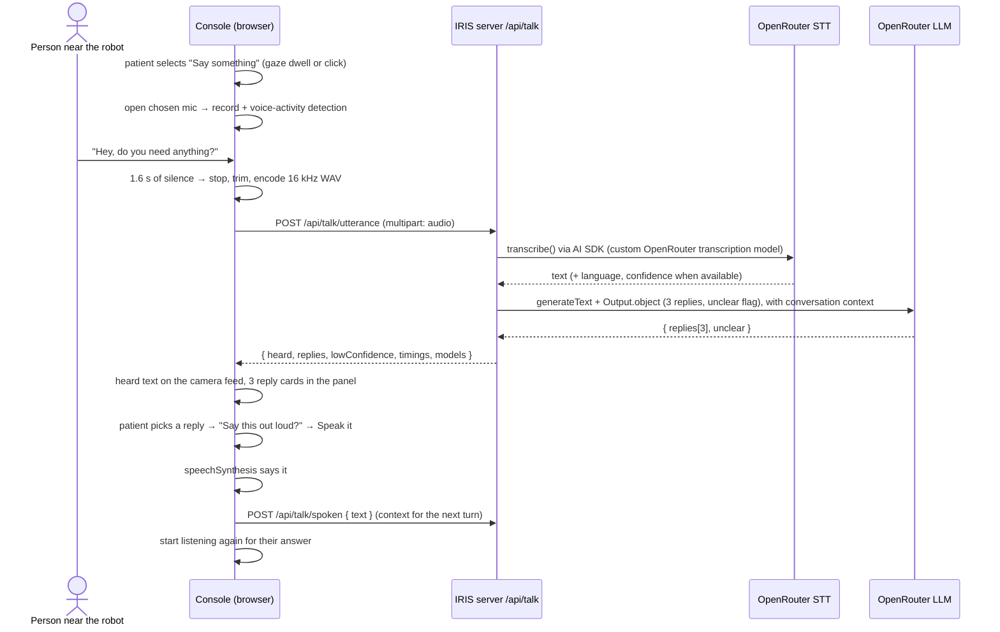

# Say something: listen, transcribe, suggest replies

> **IRIS 0.6.1:** both phone capture and console Say something use the connected phone microphone and the same Talk pipeline. Laptop capture is the fallback when no phone is connected. See [current speech workflow](./speech-workflow.md); the older migration discussion below is historical.

> **Update (AutoSage):** replies now come from **AutoSage fast-query on the patient's medical knowledge base**, and every conversation lives in **one AutoSage chat**. The OpenRouter reply models below are the **fallback**. The talk routes now take a `conversationId` and require the **patient** role. See [care.md](./care.md) §4–5 and §7 for the changed API.

This is the IRIS version of gaze-connects' **Talk Live** feature (see [talk-live.md](./talk-live.md)).

Someone near the robot speaks. IRIS records it, turns it into text, and an LLM suggests **three short replies**. The patient picks one with their eyes, confirms, and IRIS says it out loud. IRIS then listens for the answer, so the conversation keeps going.

- **Audio:** the connected phone records and plays; without a phone, the selected laptop microphone and browser TTS are used.
- **AI:** shared OpenRouter transcription, then AutoSage replies with OpenRouter fallback.

---

## 1. Models

Chosen on 2026-11-04 from OpenRouter's live model list (`/api/v1/models`):

| Job | Primary | Fallback | Why |
|---|---|---|---|
| Speech → text | **`openai/whisper-large-v3-turbo`** | `openai/whisper-large-v3` | Cheapest tier on OpenRouter: about **$0.012 per hour** of audio (~$0.013 per 1,000 four-second sentences), fast, and good quality. The full Whisper Large V3 ($0.027/hr) is a cheap, slightly more accurate fallback. AssemblyAI Universal-3.6 Pro ($0.30/hr, 25× more) was considered and dropped on cost |
| Text → 3 replies | **`z-ai/glm-5.3-flash`** | `deepseek/deepseek-v4-flash` | Cheapest flash model on OpenRouter with structured outputs: $0.031 in / $0.078 out per million tokens (about 3× cheaper than DeepSeek V4 Flash, 6× cheaper than Claude Haiku 5.5). Served by ~40 providers. DeepSeek V4 Flash ($0.091 / $0.182) is the fallback. Both are hybrid reasoners, so **reasoning is switched off** (`effort: "none"`) to keep replies fast |

All four are set in `apps/server/.env.schema` and can be overridden in `apps/server/.env` without code changes (`OPENROUTER_STT_MODEL`, `OPENROUTER_STT_FALLBACK_MODEL`, `OPENROUTER_REPLY_MODEL`, `OPENROUTER_REPLY_FALLBACK_MODEL`).

---

## 2. Flow



**One request instead of two.** In gaze-connects the browser called `/transcribe` and then `/options`. Here the server chains speech-to-text and replies in a single `POST /api/talk/utterance`, which saves a full round trip.

---

## 3. What changed in the console

The **Say something** card now starts a conversation. The quick phrases moved to the "Didn't catch that" view.

| View | Panel heading | Three cards | Camera feed |
|---|---|---|---|
| **Listening** | Listening… / Hearing them… | Live mic-level meter · **They're done** (stop now) · **Cancel** | Pill: "Listening for someone to speak" |
| **Thinking** | Finding replies… | "Understanding what they said…" (+ Cancel pill) | Pill: "Understanding what they said" |
| **Suggestions** | Pick a reply, or *Not sure I heard right* when confidence is low | The 3 replies (teal / honey / sky). Pills: **New replies**, **Ignore** | Honey bubble: *Someone nearby said "…"* |
| **Didn't catch that** | Didn't catch that | **Listen again** · **Quick phrases** · **Go back** | — |
| **Confirm** | Say this out loud? | Preview · **Speak it** · **Cancel** | — |
| **Speaking** | IRIS is speaking | Text + speaking bars | — |

- **Every card and pill uses dwell-to-select** (`useDwell`), so the whole flow works with gaze. That fixes gaze-connects' press-and-hold button.
- **Confirmation step:** nothing is spoken without "Speak it". gaze-connects spoke on a single click.
- **Conversation mode:** after a suggested reply is spoken, the console starts listening again on its own, because the other person usually answers. "Cancel" leaves conversation mode.
- **Mic picker (testing aid):** sits in the panel footer, above the user name. It lists every audio input and remembers the choice in `localStorage` (`iris.micDeviceId`). Device names appear after the first mic permission is granted.

---

## 4. Files

### Server (`apps/server`)

| File | What it does |
|---|---|
| `src/talk/openrouter-transcription.ts` | **AI SDK `TranscriptionModelV4` adapter** for OpenRouter's `/api/v1/audio/transcriptions`. `@openrouter/ai-sdk-provider` has no transcription model, so this lets us use the standard `transcribe()` from `ai`. Sends base64 audio + `response_format: "verbose_json"`, returns text, segments, language, duration, and `providerMetadata.openrouter.{confidence, cost, generationId}` |
| `src/talk/ai.ts` | `speechToText()`: `transcribe()` on the primary STT model, then the fallback. `suggestReplies()`: `generateText` + `Output.object(zod schema)` through `@openrouter/ai-sdk-provider`, with OpenRouter's `models: [fallback]` routing and reasoning disabled. Also holds the system prompt and `TalkError` |
| `src/talk/conversation.ts` | Per-user memory **in RAM only**: last 8 turns (heard/spoken), plus reply batches already shown for the current utterance. Resets after 15 min idle. Nothing people say is written to disk |
| `src/talk/routes.ts` | Hono router: session check, validation, endpoints (§5) |
| `src/index.ts` | `app.route("/api/talk", talkRoutes)` |
| `.env.schema` | `OPENROUTER_API_KEY` (optional, sensitive) + the 4 model IDs (public) |

### Web (`apps/web`)

| File | What it does |
|---|---|
| `src/lib/talk/recorder.ts` | `UtteranceRecorder`: mic capture through an **AudioWorklet**, downsampled to **16 kHz mono**, with **voice-activity detection** (see below). Output is a **WAV** `Blob` (the same format the robot phone will send). Also `listMicrophones()` |
| `src/lib/talk/api.ts` | `talkApi.utterance(wav)`, `.moreReplies(heard)`, `.spoken(text)`, `.reset()`, with cookies included and typed results/errors |
| `src/lib/talk/speak.ts` | `speakAloud(text)` with browser `speechSynthesis` (prefers a natural English voice, has a hang guard), plus `stopSpeaking()` |
| `src/components/console/console.tsx` | The views above, cancellation (`AbortController`), error toasts, conversation mode |
| `src/components/console/mic-picker.tsx` | Microphone dropdown |
| `src/components/console/side-panel.tsx` | Added: second header pill (`extra`), level meter and busy state on preview cards |
| `src/components/console/robot-feed.tsx` | Added: `heardLabel` and a `status` pill on the feed |

### How the voice-activity detection works

1. Learns the room's **noise floor** from the first ~200 ms, then keeps adjusting it slowly.
2. A 20 ms frame counts as speech if its RMS > max(0.012, 3 × noise floor). **4 speech frames in a row** (80 ms) start an utterance.
3. After speech starts, **1.6 s of silence** ends it. If nobody speaks within **8 s**, it stops with no upload, and the UI shows "Didn't catch that". It always stops at **20 s**.
4. The clip is trimmed to *300 ms before speech starts* through *350 ms after it ends*, then encoded as 16-bit PCM WAV.
5. "They're done" stops it immediately. Cancel throws the audio away.

---

## 5. API

All routes require a **signed-in session** (Better Auth cookie), otherwise `401 UNAUTHORIZED`. Errors look like `{ "error": CODE, "message": "human-readable" }`.

### `POST /api/talk/utterance`
`multipart/form-data`, field **`audio`** (WAV preferred; webm/mp3/m4a also work because `transcribe()` detects the format).

```jsonc
// 200 — heard something
{
  "status": "ok",
  "utteranceId": "3f0c…",
  "heard": "Hey, do you need anything?",
  "replies": ["Some water would be great.", "No thanks, I'm fine.", "Can you sit with me?"],
  "lowConfidence": false,           // LLM said "unclear" OR STT confidence < 0.55
  "language": "en",
  "timings": { "sttMs": 640, "repliesMs": 820, "totalMs": 1460 },
  "models": { "stt": "openai/whisper-large-v3-turbo", "replies": "z-ai/glm-5.3-flash" }
}
// 200 — nothing usable (clip < 8 KB, or transcript has < 2 letters/digits): no LLM call is made
{ "status": "no_speech", "timings": { … }, "models": { "stt": … } }
```

| Status | Code | When |
|---|---|---|
| 400 | `VALIDATION_ERROR` | No `audio` field |
| 413 | `AUDIO_TOO_LARGE` | > 5 MB |
| 415 | `UNSUPPORTED_MEDIA` | Not `audio/*` |
| 502 | `STT_FAILED` / `REPLIES_FAILED` | Both models failed |
| 503 | `AI_NOT_CONFIGURED` | `OPENROUTER_API_KEY` missing |

### `POST /api/talk/replies`
`{ "heard"?: string }`, which defaults to the last thing heard. Returns a **fresh** set that avoids every reply already shown for this utterance, at a slightly higher temperature: `{ heard, replies, lowConfidence, timings, models }`.

### `POST /api/talk/spoken`
`{ "text": string }`. Records what the patient actually said, so the next suggestions can understand follow-ups ("Which one?", "Is that enough?").

### `POST /api/talk/reset`
Forgets the conversation.

### `GET /api/talk/status`
`{ ready, models: { stt: [...], replies: [...] } }` shows whether a key is set and which models are configured.

### The prompt (summary)

The system prompt is in `src/talk/ai.ts`.
- Output is **exactly 3** first-person spoken replies, each **≤ 12 words**, and clearly different (yes / no / ask or buy time when that fits).
- They use the recent conversation to resolve "it", "that", and so on, and reply in the speaker's language.
- They contain **no medical claims**, no emojis and no numbering.
- If the input is garbled, the model sets `unclear: true` and offers polite "could you repeat that" style replies.

The output is validated by a zod schema (`replies.length(3)`, `unclear: boolean`). Duplicates are removed, and a short or duplicate result counts as a failure.

---

## 6. Setup

1. Get a key at <https://openrouter.ai/keys> and add credits.
2. Put the key in `apps/server/.env`, which is git-ignored:
   ```env
   OPENROUTER_API_KEY=sk-or-v1-…
   ```
3. Restart `bun run dev`. `GET /api/talk/status` should say `"ready": true`.
4. Open the console, pick the laptop mic in the footer, select **Say something**, and talk.

The browser console logs each round's timings: `[talk] heard in … ms, replies in … ms`.

---

## 6b. Working together with the robot phone (after the Android merge)

The console now has the phone pairing bar from the Android companion (docs/mobile.md). Both paths work side by side:

| | Laptop mic ("Say something") | Robot phone (hub) |
|---|---|---|
| Who listens | `UtteranceRecorder` on the mic picked in the footer | Phone app (on-device STT for now) |
| How suggestions arrive | `POST /api/talk/utterance` response | `suggestions` message over the hub WebSocket |
| **Speak it** | **Phone connected → `speak` over the hub** (the phone says it and reports `tts_status`); **no phone → spoken on the laptop** | Same |
| After speaking a talk reply | `/api/talk/spoken` records it in the conversation's AutoSage chat, then IRIS listens again (on the phone path once `tts_status: finished` arrives) | — |

Hub suggestions that are low-confidence show the phone flow's "Could you repeat that?" cards. Talk replies stay pickable, because AutoSage already phrases unsure replies as clarifying questions, and they get a **New replies** pill.

## 6c. New person, new conversation

How the phone's audio reaches the server and the console (`POST /api/utterance` → the same `/api/talk/utterance` route → `talk_result` over the hub) is described in [speech-workflow.md](./speech-workflow.md). This section covers how those utterances are grouped into conversations.

IRIS can't tell voices apart (speech-to-text gives words, not speakers), so `apps/server/src/talk/turn-taking.ts` decides **after** transcription, in both `/api/talk/utterance` and `/api/talk/transcript`:

- **Silence ≥ 90 s** since the last turn → new conversation and new AutoSage chat (`newConversation: "silence"`).
- **Opener after ≥ 15 s of quiet**: "hi/hello/hey/namaste/good morning…", "excuse me…", or an introduction in the first words ("I'm Ravi…", "my name is…", "this is Dr. Mehta") → new conversation (`newConversation: "greeting"`). "I'm fine / I'm not sure…" don't count.
- **Prompt guard** for anything that slips through: the prompt tells AutoSage the speaker may be someone new, and if a line could be a fresh start it must not bring up earlier topics, medicines or results unless asked.
- **No words, no conversation:** silent, filler-only or low-confidence clips return `no_speech` before a conversation is opened, so noise can't end the current one. Their `conversationId` is the one sent in (it can be `null`).
- **Console:** a result with `newConversation` set shows a toast ("New conversation: sounds like someone new" / "…after a long pause"), and the caption reads **"Someone new said"**. This works for both phone results (`talk_result`) and laptop recordings. The patient can still end a conversation any time.
- **Verified live (2026-11-04):** A asks about baclofen → B, 16 s later, says "Hello! I'm Ravi…" (new chat, replies greet Ravi) → B: "Is it any better?" (same chat, no medicine talk from A's chat) → 95 s quiet then "Can you hear me?" (new chat). Unit tests: `apps/server/tests/turn-taking.test.ts`.

## 7. Moving to the robot phone

The server pipeline doesn't change. Only who records and who speaks:

| Step | Now (testing) | Later (robot) |
|---|---|---|
| 1. Record | `UtteranceRecorder` on the laptop mic | Phone app VAD (mobile.md M5) records **the same 16 kHz WAV** |
| 2. Send | Browser → `POST /api/talk/utterance` | Phone → the same endpoint (phone authenticates with a device token or via the hub) |
| 3–4. STT → LLM | `speechToText()` → `suggestReplies()` | unchanged |
| 5. Show | Response of the request | Server pushes `transcript` + `suggestions` to the web console over the hub WebSocket (interfaces.md §3) |
| 6. Speak | `speakAloud()` on the laptop | Console sends `speak`, the phone's TTS says it, and `tts_status` comes back |

When that lands, `console.tsx` replaces `talkApi.utterance()` with a hub listener and `speakAloud()` with `hub.send({ type: "speak", … })`. Both spots are marked `TODO` in the code.

---

## 8. Improvements over gaze-connects

| gaze-connects Talk Live | IRIS Say something |
|---|---|
| Press-and-hold mic button (not gaze-usable) | One dwell to start; stops on its own when the speaker stops |
| 2 sequential requests from the browser | 1 request; the server chains STT → LLM |
| Groq keys rotated by hand | OpenRouter with a fallback model for both steps |
| 4 options, ≤ 40 words | 3 options, ≤ 12 words (fits the three cards, quick to read) |
| Global "don't repeat" list shared by all users | Per-user conversation memory: heard + spoken turns, plus "already shown" for New replies |
| Speaks on click | Confirmation step before speaking |
| Endpoints open to anyone | Session required |
| Silence burned through every API key and showed "Unable to transcribe" | Silence never reaches the API (browser speech detection + server size/length checks) and returns `no_speech` |
| MediaRecorder webm, misnamed on Safari | Always WAV 16 kHz from an AudioWorklet |
| No low-confidence handling | STT confidence + LLM `unclear` flag → "Not sure I heard right" |

---

## 9. Verified so far

Checked locally without an OpenRouter key:

- `401` without a session; `400` for a missing file; `no_speech` for a tiny clip; `503 AI_NOT_CONFIGURED` for a real spoken clip; `/spoken` → `200`.
- Browser, with a simulated mic signal: listening → speech detected ("Hearing them…") → stops on silence → **72 KB 16 kHz WAV** uploaded → error handled and back to home.

**Not yet verified:** a live round trip through OpenRouter (needs `OPENROUTER_API_KEY`), and speech-detection thresholds in a noisy hall.
